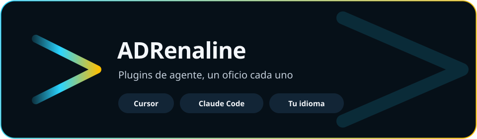
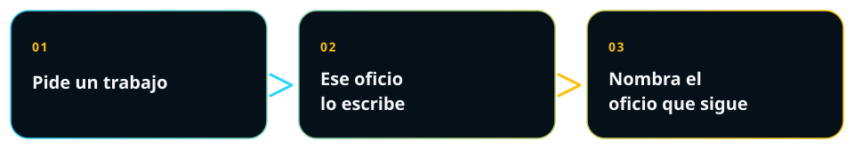

Idioma:&emsp; 

  

# Plugins de agente para Cursor y Claude Code

Tu agente, con oficio. Pide el diagrama UML, la arquitectura, la pantalla, las palabras de esa pantalla, el contrato de la API o la prueba. Lo escribe el plugin que sabe hacer ese trabajo. Si el siguiente trabajo es de otro oficio, ese plugin lo nombra.

Hay dieciséis plugins listos. Corren en Cursor y en Claude Code. Pides en tu idioma. El archivo que guarda sigue ese idioma.

  

##  Instala uno

<table>
<tr>
<td width="33%" valign="top">

**Cursor**

Abre Customize e instala el plugin desde su repositorio. Uno para empezar es [diagramas UML](https://github.com/ADRenaline-Suite/plugin-uml-diagrams).

</td>
<td width="34%" valign="top">

**Claude Code**

<pre>claude plugin marketplace add ADRenaline-Suite/plugin-uml-diagrams
claude plugin install plugin-uml-diagrams@plugin-uml-diagrams</pre>

Cambia el nombre por el oficio que quieras.

</td>
<td width="33%" valign="top">

**Otro agente**

Instala el skill con el comando de ese agente. Los skills viajan. Las rules, los commands y los hooks cargan en Cursor y en Claude Code.

</td>
</tr>
</table>

Los archivos quedan en tu proyecto. Sigue el bloque que corresponde al proyecto que tienes.

##  Cuando todavía no hay nada construido

1. [Foto del proyecto](https://github.com/ADRenaline-Suite/plugin-project-context) — qué es el proyecto, y qué plugins encajan.
2. [Project manager](https://github.com/ADRenaline-Suite/plugin-project-manager) — el caso de uso del que parten los demás oficios.
3. [Arquitectura](https://github.com/ADRenaline-Suite/plugin-software-architect) — las vistas y la decisión. Una vista UML es [Diagramas](https://github.com/ADRenaline-Suite/plugin-uml-diagrams).
4. [Diseño de interfaz](https://github.com/ADRenaline-Suite/plugin-ui-ux-design), [Textos de interfaz](https://github.com/ADRenaline-Suite/plugin-ux-writing) y [Accesibilidad](https://github.com/ADRenaline-Suite/plugin-accessibility) — si la gente va a usar una pantalla.
5. [APIs](https://github.com/ADRenaline-Suite/plugin-apis), [Backend](https://github.com/ADRenaline-Suite/plugin-backend) y [Frontend](https://github.com/ADRenaline-Suite/plugin-frontend) — el contrato, el dominio y la pantalla.
6. [QA](https://github.com/ADRenaline-Suite/plugin-qa-engineer), [Seguridad](https://github.com/ADRenaline-Suite/plugin-security) y [Documentación](https://github.com/ADRenaline-Suite/plugin-documentation) — la prueba, la amenaza y la página para quien lee.

##  Cuando el proyecto ya está construido

1. [Foto del proyecto](https://github.com/ADRenaline-Suite/plugin-project-context) — lee el repositorio y nombra el hueco.
2. Abre el oficio que cubre ese hueco.

- No hay caso de uso, sprint u orden del trabajo — [Project manager](https://github.com/ADRenaline-Suite/plugin-project-manager)
- La forma no está explicada, o hay una decisión abierta — [Arquitectura](https://github.com/ADRenaline-Suite/plugin-software-architect)
- Una pantalla por especificar — [Diseño de interfaz](https://github.com/ADRenaline-Suite/plugin-ui-ux-design)
- Las palabras de esa pantalla — [Textos de interfaz](https://github.com/ADRenaline-Suite/plugin-ux-writing)
- Si la gente puede usar la pantalla — [Accesibilidad](https://github.com/ADRenaline-Suite/plugin-accessibility)
- Un contrato HTTP — [APIs](https://github.com/ADRenaline-Suite/plugin-apis)
- Las reglas del dominio — [Backend](https://github.com/ADRenaline-Suite/plugin-backend)
- Una pantalla por construir desde el handoff — [Frontend](https://github.com/ADRenaline-Suite/plugin-frontend)
- Una prueba que vuelve al caso de uso — [QA](https://github.com/ADRenaline-Suite/plugin-qa-engineer)
- Qué puede salir mal — [Seguridad](https://github.com/ADRenaline-Suite/plugin-security)
- Una página para un tipo de lector — [Documentación](https://github.com/ADRenaline-Suite/plugin-documentation)
- Un diagrama UML que pidió un oficio — [Diagramas](https://github.com/ADRenaline-Suite/plugin-uml-diagrams)

##  Al lado de los dos caminos

- [Cronología](https://github.com/ADRenaline-Suite/plugin-chronology) — una nota por chat de qué se intentó, y si funcionó.
- [Confirmación](https://github.com/ADRenaline-Suite/plugin-action-confirmation) — la frase exacta de ese turno, antes de escribir en un servidor, una base o un repositorio remoto.
- [Privacidad](https://github.com/ADRenaline-Suite/plugin-privacy) — qué hace el producto con los datos de una persona.

##  Ver el sistema

- [Diagramas](https://github.com/ADRenaline-Suite/plugin-uml-diagrams) — una imagen del sistema, en la notación que pediste.
- [Arquitectura](https://github.com/ADRenaline-Suite/plugin-software-architect) — la explicación que se puede seguir, vista por vista.
- [Foto del proyecto](https://github.com/ADRenaline-Suite/plugin-project-context) — qué es el proyecto hoy, y qué plugins encajan.
- [Cronología](https://github.com/ADRenaline-Suite/plugin-chronology) — qué se intentó en este proyecto, y si funcionó.
- [Project manager](https://github.com/ADRenaline-Suite/plugin-project-manager) — el caso de uso, el sprint, el avance, el orden del trabajo.
- [Documentación](https://github.com/ADRenaline-Suite/plugin-documentation) — una página para un tipo de lector.

##  Darle forma a lo que la gente toca

- [Diseño de interfaz](https://github.com/ADRenaline-Suite/plugin-ui-ux-design) — de la tarea a una pantalla que se puede construir.
- [Textos de interfaz](https://github.com/ADRenaline-Suite/plugin-ux-writing) — las palabras de esa pantalla, en los idiomas del producto.
- [Accesibilidad](https://github.com/ADRenaline-Suite/plugin-accessibility) — la comprobación de que la gente sí puede usarla.

##  Construirlo

- [APIs](https://github.com/ADRenaline-Suite/plugin-apis) — el contrato que un cliente puede llamar.
- [Backend](https://github.com/ADRenaline-Suite/plugin-backend) — las reglas del dominio, en el lenguaje que el proyecto ya usa.
- [Frontend](https://github.com/ADRenaline-Suite/plugin-frontend) — la pantalla, construida desde el handoff, con sus estados.
- [QA](https://github.com/ADRenaline-Suite/plugin-qa-engineer) — la prueba que vuelve al caso de uso.

##  Dejar constancia

- [Seguridad](https://github.com/ADRenaline-Suite/plugin-security) — qué puede salir mal, y el requisito que se puede verificar.
- [Privacidad](https://github.com/ADRenaline-Suite/plugin-privacy) — qué hace el producto con los datos de una persona.
- [Confirmación](https://github.com/ADRenaline-Suite/plugin-action-confirmation) — el agente espera tu frase exacta antes de escribir.

## Preguntas

¿Qué es ADRenaline?

Una suite de plugins de agente. Cada plugin hace un oficio y escribe ese artefacto en tu proyecto. Un oficio que piden varios roles es su propio plugin. Los demás lo señalan.

¿Cómo instalo un plugin en Cursor?

Abre Customize e instala el plugin desde su repositorio en GitHub.

¿Cómo instalo un plugin en Claude Code?

Añade el repositorio como marketplace y después instala el plugin. Los dos comandos están en Instala uno. El ejemplo es diagramas UML. Cambia el nombre por el oficio que quieras.

¿En qué idioma pido?

En el idioma de tu pedido. El archivo que el plugin guarda sigue ese idioma. Esta página está en español y en inglés.

