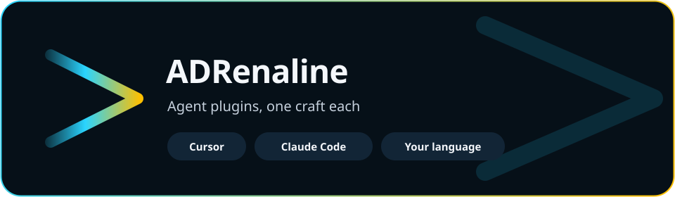
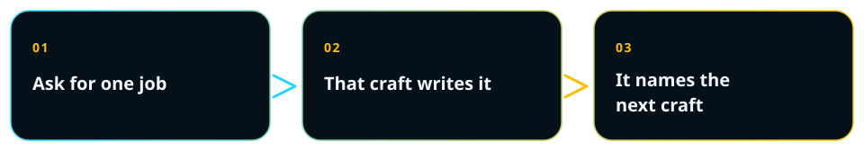

Language:&emsp; 

  

# Agent plugins for Cursor and Claude Code

Your agent, with a craft. Ask for the UML diagram, the architecture, the screen, the words on that screen, the API contract, or the test. The plugin that knows that job writes the file. When the next job belongs to another craft, it names that plugin.

Sixteen plugins are ready. They run in Cursor and in Claude Code. You ask in your language. The file it saves follows that language.

  

##  Install one plugin

<table>
<tr>
<td width="33%" valign="top">

**Cursor**

Open Customize and install the plugin from its repository. A first one to try is [UML diagrams](https://github.com/ADRenaline-Suite/plugin-uml-diagrams).

</td>
<td width="34%" valign="top">

**Claude Code**

<pre>claude plugin marketplace add ADRenaline-Suite/plugin-uml-diagrams
claude plugin install plugin-uml-diagrams@plugin-uml-diagrams</pre>

Swap the name for the craft you want.

</td>
<td width="33%" valign="top">

**Another agent**

Install the skill with that agent's own command. The skills travel. Rules, commands, and hooks load in Cursor and in Claude Code.

</td>
</tr>
</table>

The files land in your project. Follow the block that matches the project you have.

##  When nothing is built yet

1. [Project picture](https://github.com/ADRenaline-Suite/plugin-project-context) — what the project is, and which plugins fit.
2. [Project manager](https://github.com/ADRenaline-Suite/plugin-project-manager) — the use case the other crafts start from.
3. [Architecture](https://github.com/ADRenaline-Suite/plugin-software-architect) — the views and the decision. A UML view is [Diagrams](https://github.com/ADRenaline-Suite/plugin-uml-diagrams).
4. [Interface design](https://github.com/ADRenaline-Suite/plugin-ui-ux-design), [Interface writing](https://github.com/ADRenaline-Suite/plugin-ux-writing), and [Accessibility](https://github.com/ADRenaline-Suite/plugin-accessibility) — when people will use a screen.
5. [APIs](https://github.com/ADRenaline-Suite/plugin-apis), [Backend](https://github.com/ADRenaline-Suite/plugin-backend), and [Frontend](https://github.com/ADRenaline-Suite/plugin-frontend) — the contract, the domain, and the screen.
6. [QA](https://github.com/ADRenaline-Suite/plugin-qa-engineer), [Security](https://github.com/ADRenaline-Suite/plugin-security), and [Documentation](https://github.com/ADRenaline-Suite/plugin-documentation) — the test, the threat, and the page for the reader.

##  When the project is already built

1. [Project picture](https://github.com/ADRenaline-Suite/plugin-project-context) — it reads the repository and names the gap.
2. Open the craft that fills that gap.

- No use case, sprint, or order of work — [Project manager](https://github.com/ADRenaline-Suite/plugin-project-manager)
- The shape is unexplained, or a decision is open — [Architecture](https://github.com/ADRenaline-Suite/plugin-software-architect)
- A screen to specify — [Interface design](https://github.com/ADRenaline-Suite/plugin-ui-ux-design)
- The words on that screen — [Interface writing](https://github.com/ADRenaline-Suite/plugin-ux-writing)
- Whether people can use the screen — [Accessibility](https://github.com/ADRenaline-Suite/plugin-accessibility)
- An HTTP contract — [APIs](https://github.com/ADRenaline-Suite/plugin-apis)
- The rules of the domain — [Backend](https://github.com/ADRenaline-Suite/plugin-backend)
- A screen to build from a handoff — [Frontend](https://github.com/ADRenaline-Suite/plugin-frontend)
- A test that traces to the use case — [QA](https://github.com/ADRenaline-Suite/plugin-qa-engineer)
- What can go wrong — [Security](https://github.com/ADRenaline-Suite/plugin-security)
- A page for one kind of reader — [Documentation](https://github.com/ADRenaline-Suite/plugin-documentation)
- A UML diagram a craft asked for — [Diagrams](https://github.com/ADRenaline-Suite/plugin-uml-diagrams)

##  Beside either path

- [Chronology](https://github.com/ADRenaline-Suite/plugin-chronology) — one note per chat of what was tried, and whether it worked.
- [Action confirmation](https://github.com/ADRenaline-Suite/plugin-action-confirmation) — the exact phrase in that turn, before a write to a server, a database, or a remote repository.
- [Privacy](https://github.com/ADRenaline-Suite/plugin-privacy) — what the product does with a person's data.

##  See the system

- [Diagrams](https://github.com/ADRenaline-Suite/plugin-uml-diagrams) — a picture of the system, in the notation you asked for.
- [Architecture](https://github.com/ADRenaline-Suite/plugin-software-architect) — the explanation a reader can follow, view by view.
- [Project picture](https://github.com/ADRenaline-Suite/plugin-project-context) — what the project is today, and which plugins fit.
- [Chronology](https://github.com/ADRenaline-Suite/plugin-chronology) — what was tried in this project, and whether it worked.
- [Project manager](https://github.com/ADRenaline-Suite/plugin-project-manager) — the use case, the sprint, the status, the order of the work.
- [Documentation](https://github.com/ADRenaline-Suite/plugin-documentation) — one page for one kind of reader.

##  Shape what people touch

- [Interface design](https://github.com/ADRenaline-Suite/plugin-ui-ux-design) — from the task to a screen someone can build.
- [Interface writing](https://github.com/ADRenaline-Suite/plugin-ux-writing) — the words on that screen, in the languages of the product.
- [Accessibility](https://github.com/ADRenaline-Suite/plugin-accessibility) — the check that people can actually use it.

##  Build it

- [APIs](https://github.com/ADRenaline-Suite/plugin-apis) — the contract a client can call.
- [Backend](https://github.com/ADRenaline-Suite/plugin-backend) — the rules of the domain, in the language the project already uses.
- [Frontend](https://github.com/ADRenaline-Suite/plugin-frontend) — the screen, built from the handoff, with its states.
- [QA](https://github.com/ADRenaline-Suite/plugin-qa-engineer) — the test that traces back to the use case.

##  Leave a record you can trust

- [Security](https://github.com/ADRenaline-Suite/plugin-security) — what can go wrong, and the requirement you can verify.
- [Privacy](https://github.com/ADRenaline-Suite/plugin-privacy) — what the product does with a person's data.
- [Action confirmation](https://github.com/ADRenaline-Suite/plugin-action-confirmation) — the agent waits for your exact phrase before it writes.

## Questions

What is ADRenaline?

A suite of agent plugins. Each plugin does one craft and writes that artifact in your project. A craft that several roles need is its own plugin. The others point to it.

How do I install a plugin in Cursor?

Open Customize and install the plugin from its repository on GitHub.

How do I install a plugin in Claude Code?

Add the repository as a marketplace, then install the plugin. The two commands are under Install one plugin. The example is UML diagrams. Swap the name for the craft you want.

Which language do I use?

The language of your request. The file the plugin saves follows that language. This page is in English and in Spanish.

